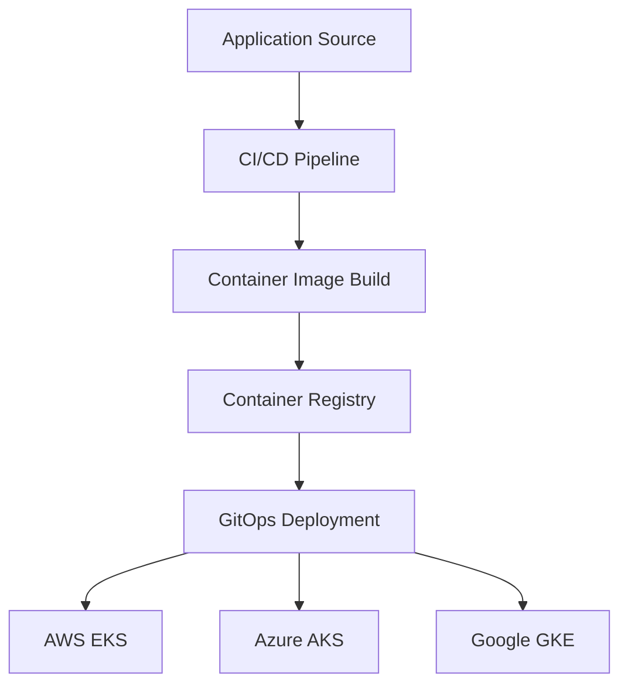
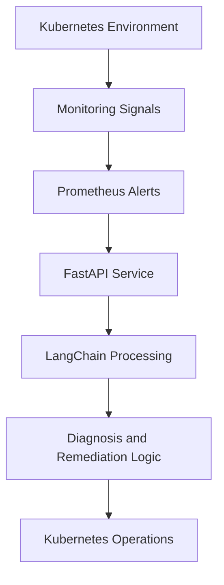
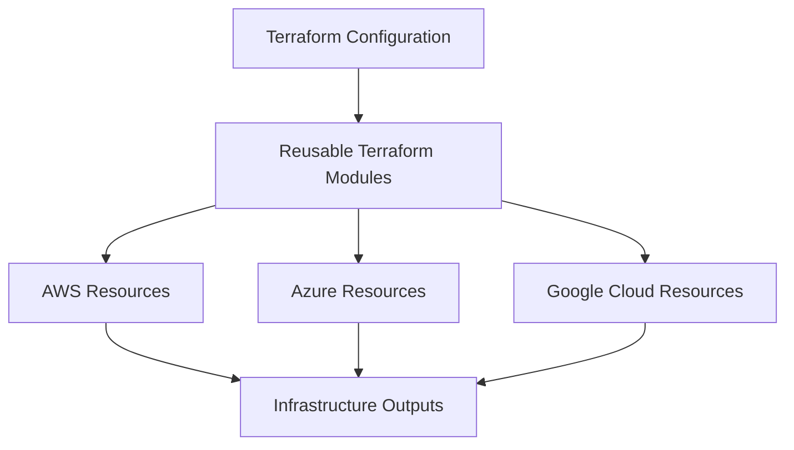
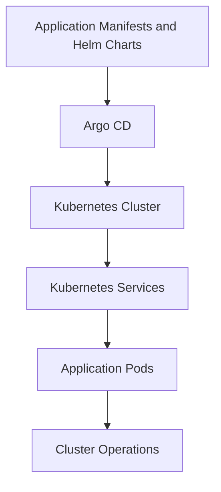
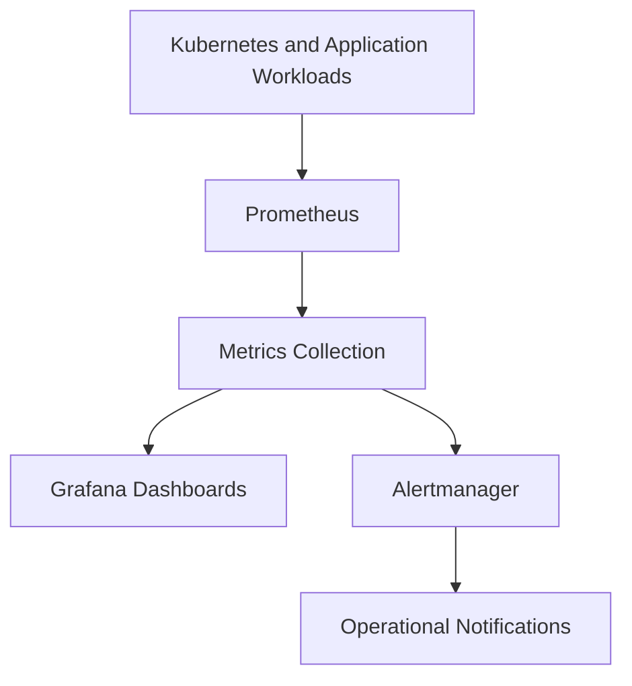
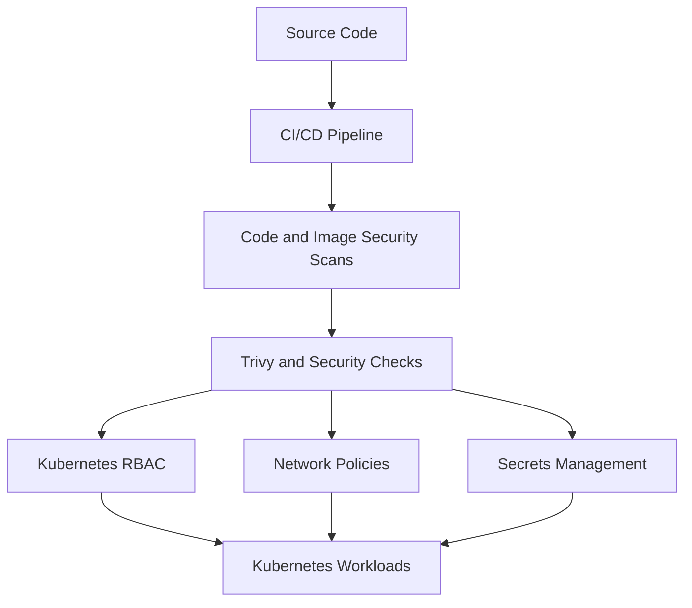
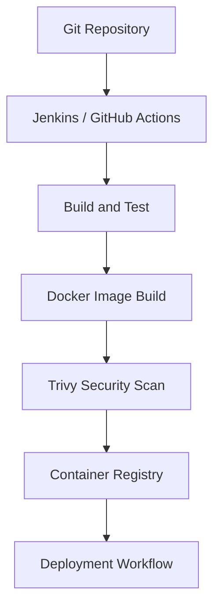
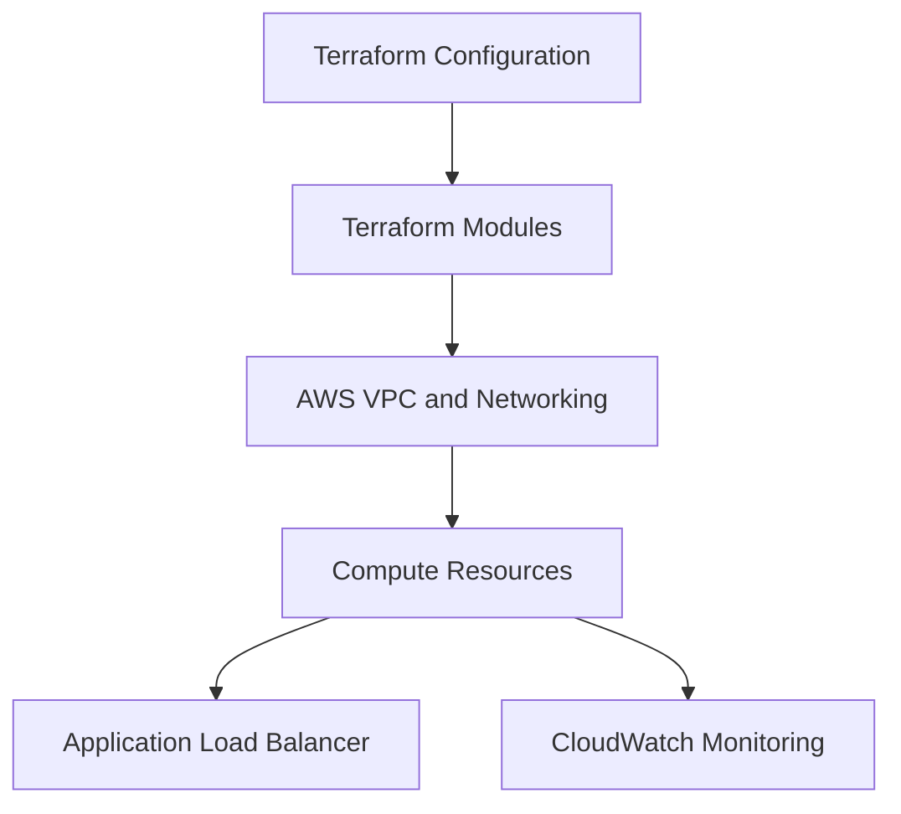

### Multi-Cloud DevOps Engineer | Kubernetes | Platform Engineering | DevSecOps

**3.8 Years of Experience** building, automating and supporting cloud-native infrastructure.

<a href="#saurabh-about-me">About Me</a> •
<a href="#saurabh-tech-stack">Tech Stack</a> •
<a href="#saurabh-capabilities">Capabilities</a> •
<a href="#saurabh-projects">Projects</a> •
<a href="#saurabh-freelance">Freelance Services</a> •
<a href="#saurabh-activity">GitHub Activity</a> •
<a href="#saurabh-certifications">Certifications</a> •
<a href="#saurabh-current-focus">Current Focus</a> •
<a href="#saurabh-contact">Contact</a>

---

## 👨‍💻 About Me

### Building, Automating & Improving Cloud Infrastructure

> I'm a **DevOps Engineer with 3.8 years of experience**, specializing in multi-cloud infrastructure, Kubernetes platforms, infrastructure automation and cloud-native operations.
>
> I enjoy building reliable deployment workflows, automating infrastructure, improving platform observability and troubleshooting complex cloud environments.
>
> My experience spans cloud platforms, container orchestration, CI/CD automation, Infrastructure as Code, DevSecOps and monitoring.

<table>
<tr>
<td width="33%" valign="top" align="center">

**☁️ Cloud Platforms**

Amazon Web Services (AWS) Microsoft Azure Google Cloud Platform (GCP)

</td>
<td width="33%" valign="top" align="center">

**☸️ Containerization & Orchestration**

Kubernetes: EKS, AKS and GKE Docker and Helm

</td>
<td width="33%" valign="top" align="center">

**🏗️ Infrastructure Automation**

Terraform and CloudFormation Ansible Infrastructure provisioning and configuration management

</td>
</tr>
<tr>
<td width="33%" valign="top" align="center">

**🔄 CI/CD & GitOps**

Jenkins GitHub Actions GitLab CI/CD Argo CD

</td>
<td width="33%" valign="top" align="center">

**🔐 Security & DevSecOps**

Trivy, SonarQube and Checkmarx Kubernetes RBAC and Network Policies Container image scanning and secrets management practices

</td>
<td width="33%" valign="top" align="center">

**📊 Monitoring & Observability**

Prometheus and Grafana Alertmanager and Datadog AWS CloudWatch and ELK

</td>
</tr>
</table>

---

## 🧰 Tech Stack

| Category | Tools |
|:--|:--|
| ☁️ **Cloud & Kubernetes** |         |
| 🏗️ **Infrastructure as Code** |    |
| 🔄 **CI/CD & GitOps** |     |
| 🔐 **Security & DevSecOps** |    |
| 📊 **Monitoring & Observability** |      |
| 💻 **Scripting & Operating Systems** |       |

---

## ⚙️ DevOps Capabilities

| Capability | What it covers | Tools |
|:--|:--|:--|
| ☁️ **Multi-Cloud Infrastructure** | Cloud foundations, networking and infrastructure provisioning across AWS, Azure and GCP. |    |
| ☸️ **Kubernetes & Containers** | Containerization, cluster deployments, Helm and workload operations across EKS, AKS and GKE. |    |
| 🔄 **CI/CD & GitOps** | Build and deployment pipelines, GitOps workflows and release automation. |    |
| 🔐 **DevSecOps Integration** | Image scanning, code-quality checks and Kubernetes security controls. |    |
| 📊 **Monitoring & Observability** | Metrics, dashboards, alerting and operational visibility. |    |
| 🛠️ **Automation & Troubleshooting** | Terraform modules, Ansible playbooks, infrastructure diagnostics and reliability improvements. |    |

---

## 💼 Featured Projects

A selection of hands-on projects covering multi-cloud infrastructure, Kubernetes, CI/CD, security and observability.

**Every project below includes its own related architecture workflow.**

---

### 🌐 1. Multi-Cloud DevOps StudentSphere

    

> Multi-cloud DevOps project focused on deploying and managing an application across Kubernetes environments.

**🧭 Architecture Workflow**

---

### 🤖 2. AI Autonomous DevOps Healer

   

> Explores AI-assisted Kubernetes operations, monitoring signals and automated remediation workflows.

**🧭 Architecture Workflow**

---

### ☁️ 3. Terraform Multi-Cloud Infra

   

> Reusable infrastructure-as-code project for provisioning resources across AWS, Azure and Google Cloud.

**🧭 Architecture Workflow**

---

### ⚙️ 4. Kubernetes Production Setup

   

> Kubernetes configuration project covering workload deployment and cluster-level operational concepts.

**🧭 Architecture Workflow**

---

### 📊 5. Monitoring & Observability Stack

   

> Monitoring stack project using Prometheus, Grafana and supporting observability components.

**🧭 Architecture Workflow**

---

### 🔐 6. DevOps Security & Secrets

   

> DevSecOps practice project covering container scanning, Kubernetes access controls, network policies and secrets-handling patterns.

**🧭 Architecture Workflow**

---

### 🔄 7. CI/CD DevOps Pipelines

   

> Pipeline automation project using Jenkins and GitHub Actions with container build and deployment workflow examples.

**🧭 Architecture Workflow**

---

### 🏗️ 8. Terraform AWS DevOps Infrastructure

   

> AWS infrastructure automation project using Terraform modules and core networking and compute resources.

**🧭 Architecture Workflow**

---

## 🚀 Freelance DevOps Services

### Need help with cloud infrastructure, Kubernetes or DevOps automation?

I help startups, businesses, engineering teams and DevOps agencies build, automate and maintain reliable cloud infrastructure.

My focus is on practical solutions that simplify deployments, improve infrastructure visibility and make operations easier to manage.

**Working with clients across India and internationally.**

| # | Service | What I deliver | Tools |
|:--:|:--|:--|:--|
| 1 | ☁️ **Multi-Cloud Infrastructure** | • Cloud infrastructure provisioning • Cloud networking and compute resources • Terraform-based infrastructure automation |    |
| 2 | ☸️ **Kubernetes & Docker** | • Containerization and deployments • EKS, AKS and GKE workload operations • Helm charts and Kubernetes configuration |    |
| 3 | 🔄 **CI/CD & GitOps Automation** | • CI/CD pipeline implementation • Build and deployment automation • GitOps workflows using Argo CD |    |
| 4 | 🔐 **DevSecOps Integration** | • Container vulnerability scanning • Code-quality and security checks • Kubernetes RBAC and Network Policies |    |
| 5 | 📊 **Monitoring & Observability** | • Monitoring setup and dashboards • Metrics collection and alerting • Operational visibility and troubleshooting |    |
| 6 | 🛠️ **Infrastructure Automation** | • Reusable Terraform modules • Ansible playbooks • Infrastructure provisioning and configuration management |   |
| 7 | 🔍 **Cloud Troubleshooting & Optimization** | Identifying infrastructure issues, diagnosing deployment problems, investigating cloud-native application environments and improving operational reliability. |    |

<table>
<tr>
<td width="50%" valign="top" align="center">

### 🤝 Who I Work With

🚀 **Startups & Growing Businesses** 
👨‍💻 **Product & Engineering Teams** 
🏢 **Companies Needing DevOps Support** 
☁️ **DevOps & Cloud Consulting Agencies**

</td>
<td width="50%" valign="top" align="center">

### 🌍 Client Reach

**India and International Clients**

### 💼 Engagement Models

📦 **Fixed-Price Projects** 
Clearly scoped infrastructure, automation, deployment and implementation projects with agreed deliverables.

⏱️ **Hourly Engagement** 
Task-based DevOps support, troubleshooting, infrastructure assistance and technical collaboration.

</td>
</tr>
</table>

### 📩 Have a DevOps Project?

Tell me about your infrastructure, automation or deployment requirements. Let's discuss a practical solution for your team.

---

## 📈 GitHub Activity

[View my GitHub contribution history](https://github.com/manesaurabh1704-devops)

---

## 🎓 Certifications and Continuous Learning

<table>
<tr>
<td width="50%" valign="top" align="center">

**✅ Completed**

</td>
<td width="50%" valign="top" align="center">

**🟡 In Progress**

</td>
</tr>
</table>

---

## 🎯 Current Focus

My focus is on developing practical, reusable DevOps solutions and delivering reliable infrastructure and automation outcomes.

<table>
<tr>
<td width="50%" valign="top">

### 🏗️ Infrastructure & Platform Engineering

Building reusable multi-cloud infrastructure patterns, Terraform modules and Kubernetes deployment workflows.

</td>
<td width="50%" valign="top">

### 🔄 Automation & Delivery

Developing repeatable CI/CD pipelines, GitOps workflows and automated deployment processes.

</td>
</tr>
<tr>
<td width="50%" valign="top">

### 🔐 Security & Reliability

Integrating security checks, monitoring, alerting and operational troubleshooting into cloud-native environments.

</td>
<td width="50%" valign="top">

### 📚 Documentation & Engineering

Creating practical projects with clear architecture, implementation steps and maintainable documentation.

</td>
</tr>
</table>

### 🤝 Client Collaboration

| Step | How I work |
|:--:|:--|
| 1️⃣ | Understand business and technical requirements before implementation. |
| 2️⃣ | Define project scope, deliverables and a practical execution plan. |
| 3️⃣ | Build maintainable infrastructure and automation workflows. |
| 4️⃣ | Provide clear documentation and handover for completed work. |
| 5️⃣ | Collaborate through fixed-price projects or hourly engagements. |

> 📚 **Learning alongside implementation:** AWS Solutions Architect Associate (SAA-C03) and Certified Kubernetes Administrator (CKA).

---

## 📬 Contact

### Let's Build Something Reliable Together

Have a cloud, Kubernetes, CI/CD or infrastructure automation requirement?

Let's discuss your project, understand the technical requirements and explore a practical solution.

**Email:** [saurabh.mane.devops@gmail.com](mailto:saurabh.mane.devops@gmail.com)

**Engagement:** Fixed-price projects | Hourly DevOps support

*Building, automating and supporting reliable cloud infrastructure.*

Made with ❤️ by **Saurabh Mane**

