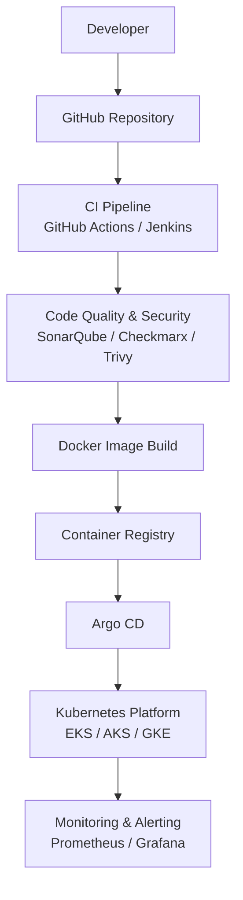
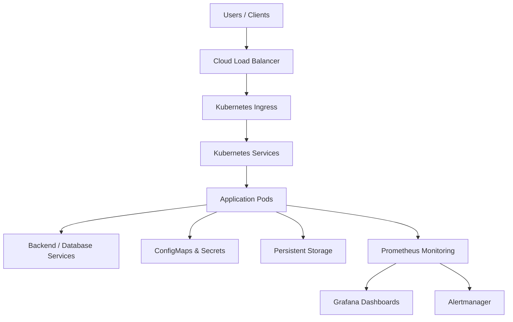
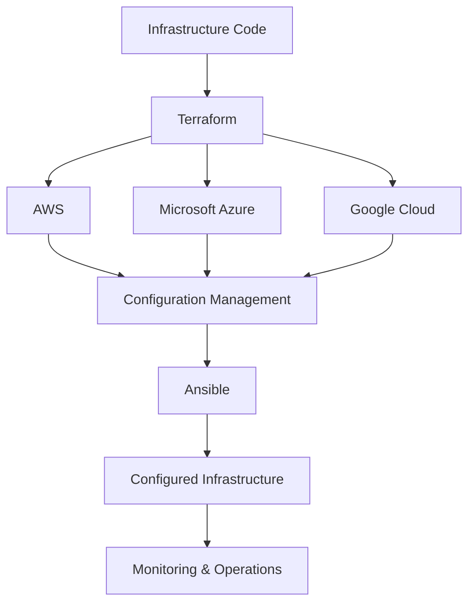
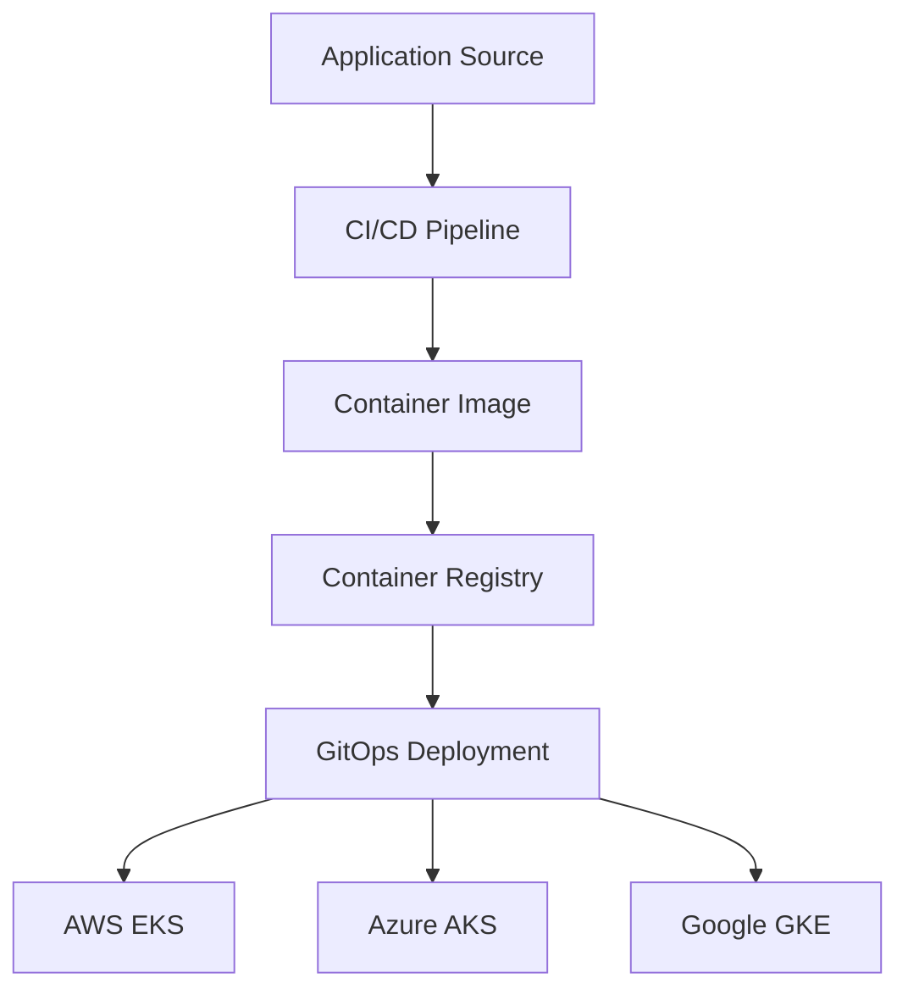
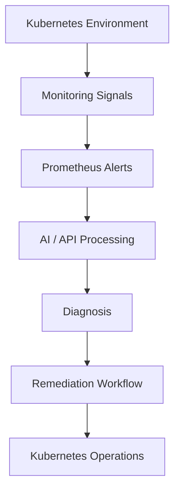
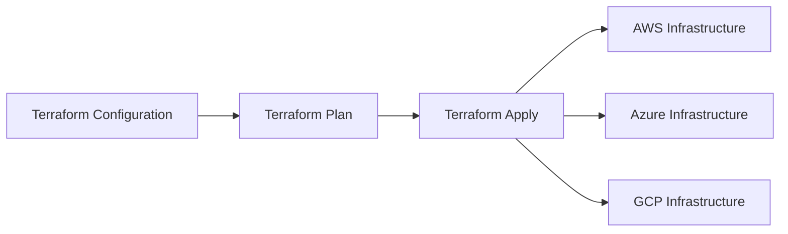

### Multi-Cloud DevOps Engineer | Kubernetes | Platform Engineering | DevSecOps

**3.8 Years of Experience** building, automating and supporting cloud-native infrastructure.

[About Me](#about-me) • [Tech Stack](#tech-stack) • [Capabilities](#devops-capabilities) • [Architecture](#architecture) • [Projects](#featured-projects) • [GitHub Activity](#github-activity) • [Certifications](#certifications-and-continuous-learning) • [Contact](#contact)

---

## 👨‍💻 About Me

I'm a **DevOps Engineer with 3.8 years of experience**, specializing in multi-cloud infrastructure, Kubernetes platforms, infrastructure automation and cloud-native operations.

I enjoy building reliable deployment workflows, automating infrastructure, improving platform observability and troubleshooting complex cloud environments.

### ☁️ Cloud Platforms
- Amazon Web Services (AWS)
- Microsoft Azure
- Google Cloud Platform (GCP)

### ☸️ Containerization & Orchestration
- Kubernetes: EKS, AKS and GKE
- Docker and Helm

### 🏗️ Infrastructure Automation
- Terraform and CloudFormation
- Ansible
- Infrastructure provisioning and configuration management

### 🔄 CI/CD & GitOps
- Jenkins
- GitHub Actions
- GitLab CI/CD
- Argo CD

### 🔐 Security & DevSecOps
- Trivy, SonarQube and Checkmarx
- Kubernetes RBAC and Network Policies
- Container image scanning and secrets management practices

### 📊 Monitoring & Observability
- Prometheus and Grafana
- Alertmanager and Datadog
- AWS CloudWatch and ELK

---

## 🧰 Tech Stack

### ☁️ Cloud & Kubernetes

### 🏗️ Infrastructure as Code

### 🔄 CI/CD & GitOps

### 🔐 Security & DevSecOps

### 📊 Monitoring & Observability

### 💻 Scripting & Operating Systems

---

## ⚙️ DevOps Capabilities

<table>
<tr>
<td width="50%" valign="top">

<h3>☁️ Multi-Cloud Infrastructure</h3>

Cloud infrastructure provisioning, networking, compute resources and multi-cloud environment management.

</td>
<td width="50%" valign="top">

<h3>☸️ Kubernetes & Containers</h3>

Containerization, Kubernetes cluster deployments, Helm charts and workload operations across EKS, AKS and GKE.

</td>
</tr>
<tr>
<td width="50%" valign="top">

<h3>🔄 CI/CD & GitOps</h3>

Automated build and deployment pipelines, GitOps workflows and release management.

</td>
<td width="50%" valign="top">

<h3>🔐 DevSecOps Integration</h3>

Container vulnerability scanning, code-quality checks and Kubernetes security controls.

</td>
</tr>
<tr>
<td width="50%" valign="top">

<h3>📊 Monitoring & Observability</h3>

Metrics collection, monitoring dashboards, alerting and operational visibility.

</td>
<td width="50%" valign="top">

<h3>🛠️ Automation & Troubleshooting</h3>

Infrastructure automation, configuration management, cloud diagnostics and reliability improvements.

</td>
</tr>
</table>

---

## 🏗️ Architecture

### 1. CI/CD & GitOps Delivery Architecture

### 2. Kubernetes Application Architecture

### 3. Multi-Cloud Infrastructure Automation

---

## 💼 Featured Projects

Hands-on projects covering multi-cloud infrastructure, Kubernetes, CI/CD automation, security and observability.

<table>
<tr>
<td width="50%" valign="top">

<h3>🌐 Multi-Cloud DevOps StudentSphere</h3>

Multi-cloud DevOps project focused on deploying and managing an application across Kubernetes environments.

</td>
<td width="50%" valign="top">

<h3>🤖 AI Autonomous DevOps Healer</h3>

Explores AI-assisted Kubernetes operations, monitoring signals and automated remediation workflows.

</td>
</tr>

<tr>
<td width="50%" valign="top">

<h3>☁️ Terraform Multi-Cloud Infra</h3>

Reusable infrastructure-as-code project for provisioning resources across AWS, Azure and Google Cloud.

</td>
<td width="50%" valign="top">

<h3>⚙️ Kubernetes Production Setup</h3>

Kubernetes configuration project covering workload deployment and cluster-level operational concepts.

</td>
</tr>

<tr>
<td width="50%" valign="top">

<h3>📊 Monitoring & Observability Stack</h3>

Monitoring stack project using Prometheus, Grafana and supporting observability components.

</td>
<td width="50%" valign="top">

<h3>🔐 DevOps Security & Secrets</h3>

DevSecOps practice project covering container scanning, Kubernetes access controls, network policies and secrets-handling patterns.

</td>
</tr>

<tr>
<td width="50%" valign="top">

<h3>🔄 CI/CD DevOps Pipelines</h3>

Pipeline automation project using Jenkins and GitHub Actions with container build and deployment workflow examples.

</td>
<td width="50%" valign="top">

<h3>🏗️ Terraform AWS DevOps Infrastructure</h3>

AWS infrastructure automation project using Terraform modules and core networking and compute resources.

</td>
</tr>
</table>

---

## 🧩 Project Architecture Workflows

### 🌐 StudentSphere – Multi-Cloud Deployment Flow

### 🤖 AI Autonomous DevOps Healer – Workflow

### 🏗️ Terraform Infrastructure – Workflow

---

## 📈 GitHub Activity

[View my complete GitHub contribution history](https://github.com/manesaurabh1704-devops)

---

## 🎓 Certifications and Continuous Learning

---

## 🎯 Current Focus

- **Building:** Multi-cloud infrastructure and Kubernetes platform workflows
- **Automating:** CI/CD, GitOps and DevSecOps processes
- **Improving:** Monitoring, reliability and operational visibility
- **Learning:** AWS Solutions Architect Associate (SAA-C03) and Certified Kubernetes Administrator (CKA)

---

## 📬 Contact

**Email:** [saurabh.mane.devops@gmail.com](mailto:saurabh.mane.devops@gmail.com)

*Always happy to discuss Cloud, Kubernetes, Automation, DevOps and Platform Engineering.*

Made with ❤️ by **Saurabh Mane**

