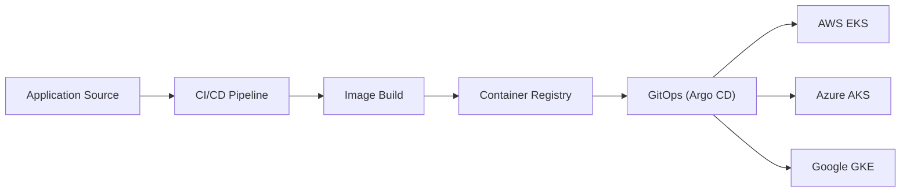
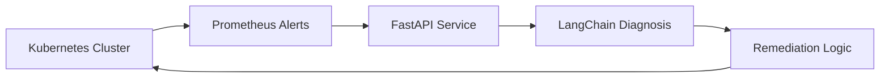
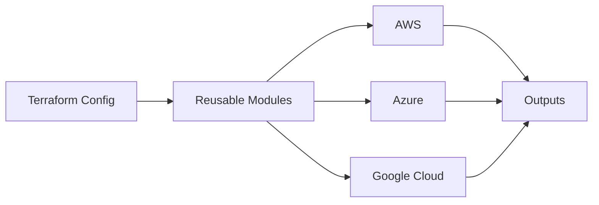
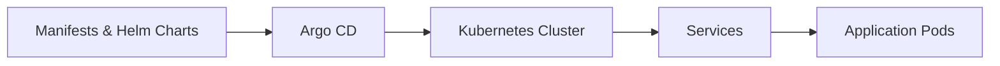
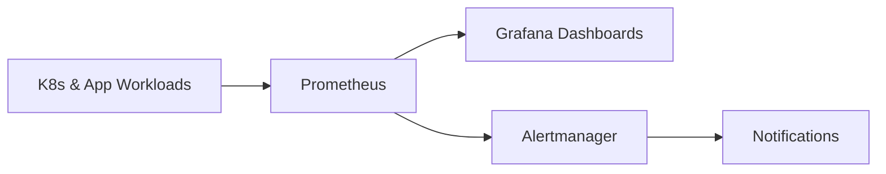
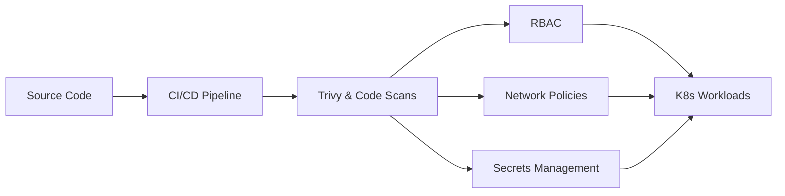
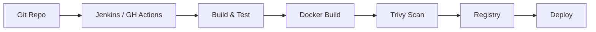
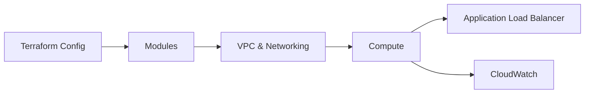

**3.8 years** building, automating and supporting cloud-native infrastructure across **AWS · Azure · GCP**

[About](#about) • [Tech Stack](#stack) • [Projects](#projects) • [Services](#services) • [Certifications](#certs) • [Contact](#contact)

---

## 👨‍💻 About Me

I'm a **DevOps Engineer** who enjoys turning messy infrastructure into reliable, automated platforms. I work across multi-cloud environments, Kubernetes, Infrastructure as Code, CI/CD, DevSecOps and observability, and I like the hard part: troubleshooting complex cloud environments until they run smoothly.

<table>
<tr>
<td width="50%" valign="top">

**🔭 What I do**
- ☁️ Provision cloud infra on AWS, Azure & GCP
- ☸️ Run workloads on EKS, AKS & GKE
- 🔄 Build CI/CD pipelines & GitOps workflows
- 🔐 Bake security into pipelines and clusters
- 📊 Set up monitoring, dashboards & alerting

</td>
<td width="50%" valign="top">

**⚡ Quick facts**
- 🧑‍💼 **Experience:** 3.8 years
- 🎯 **Focus:** Platform engineering & reliability
- 📚 **Learning:** AWS SAA-C03 & CKA
- 🌍 **Clients:** India & international
- 💼 **Open to:** Fixed-price & hourly work

</td>
</tr>
</table>

---

## 🧰 Tech Stack

| Category | Tools |
|:--|:--|
| ☁️ **Cloud** |    |
| ☸️ **Containers** |       |
| 🏗️ **IaC & Config** |    |
| 🔄 **CI/CD & GitOps** |     |
| 🔐 **DevSecOps** |     |
| 📊 **Observability** |       |
| 💻 **Scripting & OS** |       |

---

## 💼 Featured Projects

<table>
<tr>
<td width="50%" valign="top">

### 🌐 Multi-Cloud StudentSphere
Deploys and manages one application across **EKS, AKS and GKE** using a single GitOps flow.

   

[**→ View repo**](https://github.com/manesaurabh1704-devops/multi-cloud-devops-studentsphere)

</td>
<td width="50%" valign="top">

### 🤖 AI Autonomous DevOps Healer
AI-assisted Kubernetes ops: Prometheus alerts → LangChain diagnosis → **automated remediation**.

   

[**→ View repo**](https://github.com/manesaurabh1704-devops/ai-autonomous-devops-healer)

</td>
</tr>
<tr>
<td width="50%" valign="top">

### ☁️ Terraform Multi-Cloud Infra
Reusable **Terraform modules** that provision resources across AWS, Azure and Google Cloud.

   

[**→ View repo**](https://github.com/manesaurabh1704-devops/terraform-multi-cloud-infra)

</td>
<td width="50%" valign="top">

### ⚙️ Kubernetes Production Setup
Workload deployment with **Helm + Argo CD** and cluster-level operational concepts.

   

[**→ View repo**](https://github.com/manesaurabh1704-devops/kubernetes-production-setup)

</td>
</tr>
<tr>
<td width="50%" valign="top">

### 📊 Monitoring & Observability Stack
Prometheus metrics, **Grafana dashboards** and Alertmanager notifications on Kubernetes.

   

[**→ View repo**](https://github.com/manesaurabh1704-devops/monitoring-observability-stack)

</td>
<td width="50%" valign="top">

### 🔐 DevOps Security & Secrets
Image scanning, **RBAC, network policies** and secrets-handling patterns for K8s workloads.

   

[**→ View repo**](https://github.com/manesaurabh1704-devops/devops-security-secrets)

</td>
</tr>
<tr>
<td width="50%" valign="top">

### 🔄 CI/CD DevOps Pipelines
Jenkins & GitHub Actions pipelines: build → test → **Trivy scan** → registry → deploy.

   

[**→ View repo**](https://github.com/manesaurabh1704-devops/ci-cd-devops-pipelines)

</td>
<td width="50%" valign="top">

### 🏗️ Terraform AWS Infrastructure
Modular AWS setup: **VPC, compute, ALB** and CloudWatch monitoring.

   

[**→ View repo**](https://github.com/manesaurabh1704-devops/terraform-aws-devops-infrastructure)

</td>
</tr>
</table>

### 🧭 Architecture Workflows

Click any project to expand its architecture diagram.

<b>🌐 Multi-Cloud StudentSphere</b>

<b>🤖 AI Autonomous DevOps Healer</b>

<b>☁️ Terraform Multi-Cloud Infra</b>

<b>⚙️ Kubernetes Production Setup</b>

<b>📊 Monitoring & Observability Stack</b>

<b>🔐 DevOps Security & Secrets</b>

<b>🔄 CI/CD DevOps Pipelines</b>

<b>🏗️ Terraform AWS Infrastructure</b>

---

## 🚀 Freelance DevOps Services

**Need help with cloud infrastructure, Kubernetes or DevOps automation?** 
I help startups, product teams, growing businesses and DevOps agencies ship reliable infrastructure — in India and internationally.

| Service | What you get |
|:--|:--|
| ☁️ **Multi-Cloud Infrastructure** | Cloud provisioning, networking & compute on AWS / Azure / GCP using Terraform |
| ☸️ **Kubernetes & Docker** | Containerization, Helm charts, EKS / AKS / GKE workload operations |
| 🔄 **CI/CD & GitOps** | Build & deploy pipelines (Jenkins, GitHub Actions, GitLab CI), Argo CD workflows |
| 🔐 **DevSecOps** | Container vulnerability scanning, code-quality checks, RBAC & network policies |
| 📊 **Monitoring & Alerting** | Prometheus, Grafana, CloudWatch dashboards and alert setup |
| 🛠️ **Infrastructure Automation** | Reusable Terraform modules, Ansible playbooks, config management |
| 🔍 **Troubleshooting & Optimization** | Diagnosing deployment issues and improving reliability of cloud-native apps |

<table>
<tr>
<td width="50%" valign="top" align="center">

### 📦 Fixed-Price Projects
Clearly scoped work with agreed deliverables, timeline and handover docs.

</td>
<td width="50%" valign="top" align="center">

### ⏱️ Hourly Engagement
On-demand DevOps support, troubleshooting and hands-on collaboration.

</td>
</tr>
</table>

**🤝 How I work:** understand requirements → define scope & plan → build maintainable automation → hand over with clear documentation.

---

## 📈 GitHub Activity

---

## 🎓 Certifications & Learning

| Certification | Status |
|:--|:--:|
|  AWS Cloud Practitioner Essentials | ✅ Completed |
|  AWS Cloud Quest | ✅ Completed |
|  AWS Solutions Architect – Associate (SAA-C03) | 🟡 In progress |
|  Certified Kubernetes Administrator (CKA) | 🟡 In progress |

---

## 📬 Let's Build Something Reliable Together

Have a cloud, Kubernetes, CI/CD or automation requirement? Tell me about it — let's find a practical solution.

📧 **saurabh.mane.devops@gmail.com** &nbsp;•&nbsp; 💼 Fixed-price & hourly engagements

